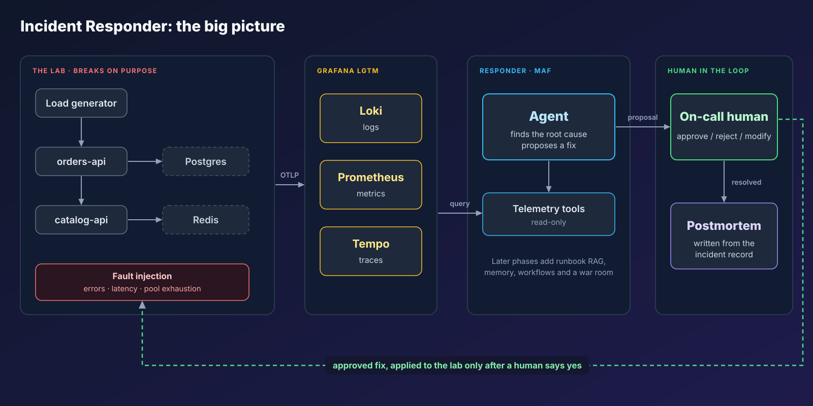

I'm a backend .NET developer, and I want to become an AI engineer without leaving .NET behind.

That sounds simple until you try it. Most AI tutorials are Python, most demos are a chatbot with a nice prompt, and I
kept finishing them with the same feeling: I can follow along, but I couldn't explain *why* any of it is built the way
it is, or when I'd say no to a given piece.

So I'm doing the thing I usually tell myself I'll do later: build one real project, slowly, and write about it as I go.
This post is the map. The posts after it are the journey.

## The project

It's called **Incident Responder**, and it's an agent that does what an on-call engineer does at 3 a.m.

Something breaks in a small lab app. The agent looks at logs, metrics and traces, works out what's actually wrong,
proposes a fix, **waits for a human to approve it**, applies it, checks that it worked, and then writes the postmortem.

It's built with [Microsoft Agent Framework](https://github.com/microsoft/agent-framework) (MAF), Microsoft's open-source
framework for agents and multi-agent workflows in .NET and Python. The code is public:
[github.com/sebnet/maf-incident-responder](https://github.com/sebnet/maf-incident-responder).

The goal is **not** a production-grade SRE tool. I'm not trying to support every telemetry backend or build a perfect UI.
The goal is to understand MAF well enough to use it on real projects, and to be able to say, for every concept I touch,
what problem it solves, how it works, and when I would *not* use it.

## Why an incident responder?

Because I wanted a project that needs most of the framework for a real reason, not to tick boxes.

- To read logs, metrics and traces, the agent needs **tools**, and I'll have to learn how to design tools that don't
  drown the model in data.
- To use the team's runbooks and remember past incidents, it needs **RAG and memory**.
- To investigate several hypotheses at the same time, it needs a **workflow** with fan-out and fan-in.
- To never restart anything without a person saying yes, it needs **human-in-the-loop** approvals.
- Incidents last hours and processes die, so it needs **checkpoints** that survive a restart.
- To show it all live, it gets a "war room" UI.
- And to write the postmortem, it needs a longer-running, self-checking agent.

There's one more reason, and it's the one I care about most: **it can be measured.** I inject the faults myself, so I know
the true root cause of every incident. That means I can score the agent instead of just feeling good about a demo.

## The lab: a system that breaks on purpose

Before any AI, there's a small "victim" system: a couple of .NET APIs orchestrated with .NET Aspire, plus a background load
generator (no traffic, no incident), all wired to OpenTelemetry and the Grafana LGTM stack (Loki for logs, Prometheus for
metrics, Tempo for traces).

A small control endpoint lets me inject realistic failures on demand. For example:

- **Errors in a dependency.** `orders-api` raises the alert, but the real culprit is `catalog-api`. A good agent has to
  follow the dependency instead of blaming the service that screamed first.
- **Latency with no errors.** Nothing is "failing", p95 just climbs.
- **Database pool exhaustion.** A proper connection-pool problem against Postgres.

Each scenario has a known root cause and a short runbook written the way an SRE team would actually write it.

## The roadmap

Six phases, about eleven weeks, one blog post (sometimes two) per phase.

| Phase | What gets built | What I'll learn |
|---|---|---|
| 0. Lab | The system that fails on demand, with queryable telemetry | Aspire, OpenTelemetry, LGTM. No MAF yet |
| 1. On-call assistant | One agent, one CLI, a structured diagnosis, and the eval runner | Agents, function tools, sessions, structured output, middleware |
| 2. Knowledge | Runbook RAG, incident memory, tools exposed over MCP | MCP, RAG, context providers, memory |
| 3. Workflow | Parallel investigation, human approval, checkpoints, then a Magentic version to compare | Workflows, fan-out/fan-in, HITL, checkpoints, orchestration |
| 4. Productization | A war room UI, durable escalation, auth, a second agent over A2A | AG-UI, hosting, durable execution, A2A, cloud evals |
| 5. Postmortem | An agent that writes the postmortem and grades its own draft | Harness agents, CodeAct, loop agents |

Phase 3 is the heart of it. I want to build the investigation as a fixed graph first, then rebuild it with a more dynamic
orchestrator and compare both on the same incidents.

## How I'll judge whether it works

Every phase ends with the same routine: tests green, an eval run (at least three repetitions per scenario), a git tag, and a
blog draft. The evals record whether the diagnosis was right, how many tool calls and tokens it took, what it cost and how
long it ran.

LLMs are non-deterministic, so single runs mean very little. Rates and averages over several runs mean something. And
when I add a feature, I want to be able to say whether it actually helped, with numbers. Sometimes the answer will be "no,
it made things worse", and I'll write that too.

## How I'm working

I'm building this together with an AI coding agent, Claude Code, and I want to be upfront about it, because I think it's
the honest way to do this.

The repo has a rule written down for agents: they work as pair programmers, not as autopilots. Before a new MAF concept
shows up, the agent has to point me to the official sample that demonstrates it and explain the problem it solves, how
it works and the main gotcha. I run the sample unchanged, break it on purpose, and only then integrate it. After that,
I write a short note about what I learned.

MAF moves fast, so another rule is that nobody (human or model) trusts memory for APIs. We check the real samples and source.

## What this series is, and isn't

It's decisions and trade-offs with real numbers, including the parts that didn't work. It's not a rewrite of the docs.

I'll be wrong in public a few times along the way, and that's part of the deal.

Next up: **Building a lab that breaks on purpose**, where I'll show how the Aspire + OpenTelemetry + Grafana setup comes
together and what it looks like when `catalog-api` starts failing.

If you're a .NET developer curious about agents, follow along, and if you spot something I got wrong, tell me.
