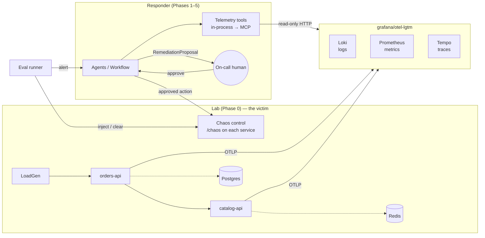

# Architecture

## Big picture

The eval runner is the only component allowed to read or change `/chaos` to set up a scenario. The responder
may only call the lab's remediation actions *after approval* (Phase 3+), and never reads the active fault.

## Layers (Clean Architecture, pragmatic)

| Layer | Project | Depends on | Knows about LLMs? |
|---|---|---|---|
| Domain | `IncidentResponder.Core` | nothing | No |
| Infrastructure | `IncidentResponder.Telemetry` | Core | No |
| AI / application | `IncidentResponder.Agents` (+ `.Workflows` in F3) | Core, MAF, M.E.AI | Yes |
| Entry points | `.Cli` (F1), `.McpServer` (F2), `.Host` (F4) | the above | via Agents |

## How it evolves per phase

| Phase | Shape |
|---|---|
| 1 | `Cli → OnCallAssistant (ChatClientAgent) → TelemetryTools → ITelemetryQuery → LGTM` |
| 2 | Tools move behind `McpServer`; agent gets `AIContextProvider`s for runbooks (RAG) and incident memory |
| 3 | `Workflow: Triage → [Investigators]* → Aggregator → Remediation → RequestPort → Execute → Verify`. The Phase 1 agent becomes an investigator executor. Magentic variant alongside. |
| 4 | `Host` exposes the workflow over AG-UI to the war room; durable timer for escalation; auth; A2A to a Deploy agent; agent OTel in LGTM |
| 5 | After resolution, a Harness agent turns the incident record into a postmortem |

## Key design decisions

See `docs/adr/`. Short version:
- **0001** One evolving project, not separate demos.
- **0002** Local telemetry backend is `grafana/otel-lgtm`, because the agent needs query APIs.
- **0003** Model access through `IChatClient` (Foundry Responses API); provider-specific agent types only when a
  phase needs a provider feature.

## Things that are deliberately realistic

- The resilience handler retries transient failures and partially masks faults, as in production.
- The alerting service is often not the root cause (s01).
- Some incidents have no error logs at all (s02, latency only).
- Injected errors use messages a real driver or runtime would produce.
